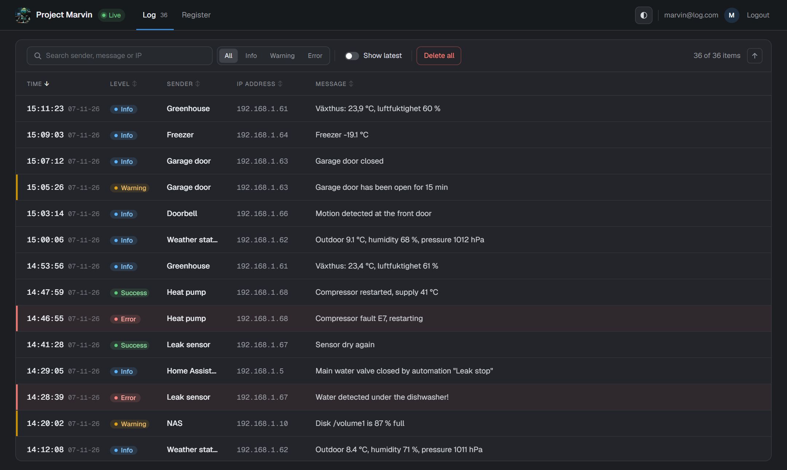
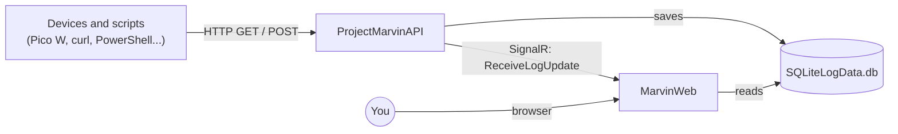
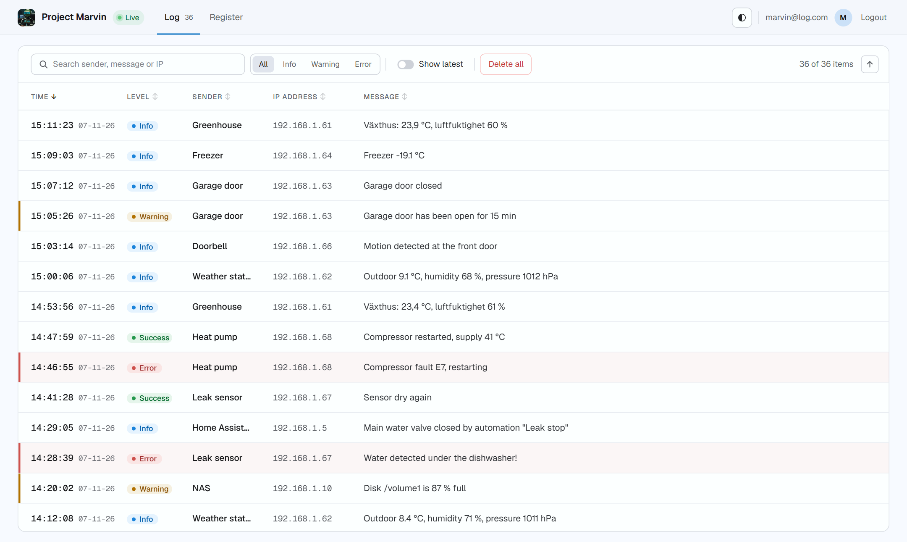
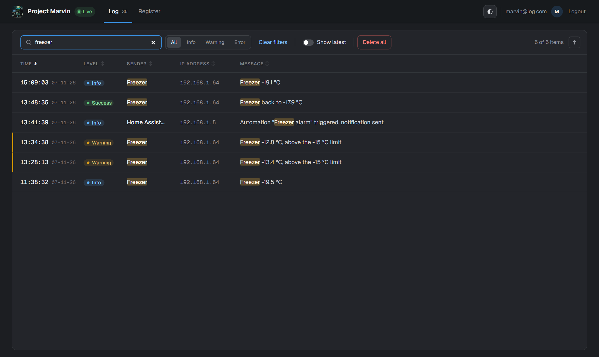
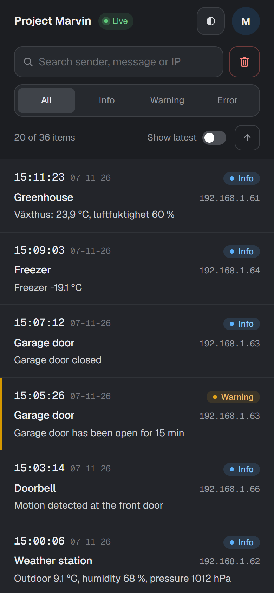
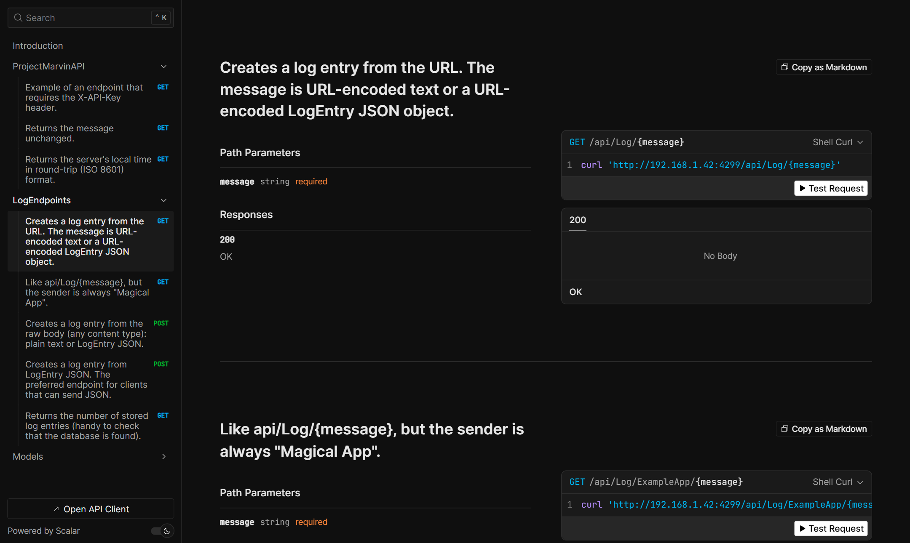

# ProjectMarvin

A self-hosted logging hub for home-built IoT devices. Sensors, microcontrollers (I use Raspberry Pi Pico W with MicroPython), scripts and servers send log entries with simple HTTP calls, and a Blazor web app shows them in real time.


*MarvinWeb: entries from every device on the network show up as they arrive.*


*This is my use case: I need to log and collect info from lots of different devices and computers.*

## The point of this project is to

1. Give myself a tool when debugging my home-built smart home stuff. I use RPi Pico W with MicroPython.
2. Have a central monitoring and logging point for all my devices and services, with API endpoints simple enough for low-end devices.
3. Be a "framework" for API functions and a web UI. Whenever I dream up a new idea, the building blocks are already in place, so adding new stuff is quick.
4. Be stepping stones for other folks who code IoT stuff and maybe are more into electronics than code.
5. ... It's always fun to build stuff with new technologies :-)

## What's in the box

The solution (`ProjectMarvin.sln`, .NET 10) has four projects:

| Project | What it is |
|---|---|
| `ProjectMarvinAPI` | ASP.NET Core Minimal API that receives log entries, saves them in SQLite and notifies the web app through SignalR. Meant for the local network only. |
| `ProjectMarvinWeb` | Blazor Server web app (MarvinWeb) with login (ASP.NET Core Identity) that shows the log. Can be exposed to the internet. |
| `Common` | The shared `LogEntry` model. |
| `ProjectMarvinAPI.Tests` | Integration tests for the API. |



The API saves each entry and broadcasts a "new data" signal on its SignalR hub (`/loghub`). MarvinWeb listens to that hub and reloads the list, so new entries appear without refreshing the page.

## MarvinWeb

- **Live log:** new entries appear as they arrive. The **Live** badge shows whether the SignalR connection to the API is up, and it reconnects automatically.
- **Search** in sender, message and IP address, with matches highlighted. Searching ignores case, including for å, ä and ö.
- **Filter** by level (Info, Warning, Error) and **sort** by any column.
- **Show latest** shows only the newest entry per device, which is handy for seeing what every device last reported.
- **Infinite scroll:** entries load 20 at a time as you scroll.
- **Dark and light theme**, a mobile layout, and it can be installed as an app (PWA).
- **Delete all** clears the log after a confirmation.
- Login is required. New accounts can only be registered by someone who is already logged in, and an account is locked for 15 minutes after 5 failed login attempts.

| Light theme | Search |
|---|---|
|  |  |



*On a phone the list turns into cards.*

## The API

All endpoints are under `/api/`. Routes are case-insensitive.

| Endpoint | What it does |
|---|---|
| `GET api/Log/{message}` | Creates a log entry from the URL. `{message}` is URL-encoded text, or a URL-encoded LogEntry JSON object. |
| `GET api/Log/ExampleApp/{message}` | Like the one above, but the sender is always "Magical App". An example of an endpoint with preset values for one app. |
| `POST api/Log/` | Creates a log entry from the raw body (any content type): plain text or LogEntry JSON. |
| `POST api/LogEx/` | Creates a log entry from LogEntry JSON. The preferred endpoint for clients that can send JSON. |
| `GET api/Echo/{message}` | Returns the message. Use it to check that Wi-Fi works. |
| `GET api/GetLocalTime` | Returns the server's local time in ISO 8601 format, for devices without a real-time clock. |
| `GET api/LogCount` | Returns the number of stored entries (handy to check that the database is found). |
| `GET api/protected` | Example of an endpoint that requires an API key. |

**Yes, GET creates log entries, on purpose.** Some single-chip sensors can only make plain HTTP GET requests, so the simplest way to log is to put the message in the URL.

A LogEntry looks like this. Only `Message` is required:

```json
{ "Sender": "Greenhouse", "LogType": "Warning", "Message": "Temperature above 30 °C", "LogDate": "2026-11-07T14:30:00" }
```

- `LogType` defaults to `Info`. MarvinWeb colors Info, Warning, Error and Success (OK); anything else is shown as debug.
- `LogDate` defaults to the time the API received the entry.
- The caller's IP address is always recorded by the server.
- Text can be UTF-8, or URL-encoded ISO-8859-1 (`%E5` = å) as the MicroPython example sends it.

**Limits:** a message is required and may be at most 8000 characters, the sender at most 200 and the log type at most 50. Invalid entries get a `400` response with a description of the problem, and request bodies larger than 64 KB get a `413`. Errors when saving are logged on the server and not returned to the device, since simple devices can't do anything useful with them.

The API is documented with [Scalar](https://scalar.com) at `http://<api-address>:4200/scalar/v1` when it runs in the Development environment.



### Sending logs

**curl**

```bash
curl "http://192.168.1.20:4200/api/Log/Hello+from+curl"
curl -X POST "http://192.168.1.20:4200/api/LogEx/" -H "Content-Type: application/json" -d "{\"Sender\":\"curl\",\"Message\":\"Hello Marvin\"}"
```

**PowerShell 7**

```powershell
Invoke-RestMethod -Method Post http://192.168.1.20:4200/api/LogEx/ -ContentType 'application/json; charset=utf-8' `
  -Body (@{ Sender = 'PowerShell'; LogType = 'Info'; Message = 'Hello Marvin' } | ConvertTo-Json)
```

**MicroPython (Pico W)**

```python
import urequests as requests
requests.get("http://192.168.1.20:4200/api/Log/Hello+from+Pico").close()
```

More examples are in [`ProjectMarvinAPI/Example Code`](ProjectMarvinAPI/Example%20Code):

- `logapi.py` and `Test MarvinAPI.py`: MicroPython for the Pico W, sending with both GET and POST. Set your own Wi-Fi details in `Test MarvinAPI.py` and the API address in `logapi.py` (another device can't use localhost).
- `API Test.http`: requests for Visual Studio or VS Code.
- `CURL.txt`: curl and PowerShell examples.
- `Test-MarvinApi.ps1`: checks a deployed API end to end. It calls Echo, GetLocalTime and LogCount, logs one entry with POST and one with GET, and checks that both were saved. Look for "Marvin API verified" in MarvinWeb afterwards.

  ```powershell
  pwsh ".\ProjectMarvinAPI\Example Code\Test-MarvinApi.ps1" -BaseUrl http://192.168.1.20:4200
  ```

## Security

The API has no login, so it must only be reachable from your local network:

- **LAN-only IP filter:** the API answers `403` to every caller outside the local network. It accepts loopback, `10.x`, `172.16–31.x`, `192.168.x` and IPv6 local addresses. It can be turned off with `"IpFilter": { "Enabled": false }`, for example if you only want to rely on IIS IP restrictions, or if devices reach the API over a VPN with other addresses.
- **API key (optional):** add `.RequireApiKey()` to an endpoint to require the `X-API-Key` header to match the `ApiKey` setting. Only `api/protected` uses it now, and when no key is configured every request to it is rejected.
- **No internal details in errors:** failures return a standard error response without exception messages.

MarvinWeb requires login, locks accounts after repeated failed logins, only lets logged-in users register new accounts, blocks redirects to other sites after login, and sends security headers (`X-Frame-Options`, `X-Content-Type-Options`, `Referrer-Policy`, `Permissions-Policy`). Use HTTPS if you expose it to the internet.

## Getting started

### Requirements

1. .NET 10 SDK
2. Visual Studio 2026, or VS Code with the C# Dev Kit
3. Nothing else: SQLite runs on all platforms, and the databases are included.

### Run it

```powershell
dotnet run --project ProjectMarvinAPI   # http://<this machine's LAN IP>:4200
dotnet run --project ProjectMarvinWeb   # https://localhost:7032
```

Log in to MarvinWeb as **Marvin@log.com / Marvin42!**. Change the password, or create a new user and delete this one, before you expose MarvinWeb to the internet.

### Configuration

| Setting | Project | What it does |
|---|---|---|
| `ConnectionStrings:LogDataConnection` | both | Path to the shared log database `SQLiteLogData.db`. Both projects must point to the same file. |
| `ConnectionStrings:IdentityConnection` | Web | Path to the login database `SQLiteLogin.db`. |
| `ConnectionStrings:SignalRAPI` | Web | The API's SignalR hub, e.g. `http://192.168.1.20:4200/loghub`. |
| `IpFilter:Enabled` | API | LAN-only IP filter, on by default. |
| `ApiKey` | API | Key for endpoints that use `.RequireApiKey()`. |
| `Marvin:Port` | API | Port when running on Kestrel, default `4200`. |

When the API runs on Kestrel (e.g. `dotnet run`), it listens on this machine's LAN IPv4 address so other devices can reach it. If you configure `Kestrel:Endpoints` yourself, that is used instead.

### Host the API safely in IIS

I host the API in IIS as its own app, reachable only from the LAN:

1. Use the IP restrictions module in IIS.
2. Under "Settings", make the default rule "Deny" with the action "Forbidden".
3. Add an Allow rule for your network. With an IP range you can enter IP address 192.168.1.0 and mask 255.255.255.0 to allow your local LAN.
4. In the site bindings, don't set a host name, but set the IP address to listen on (the IIS server's address).

Together with the API's own IP filter that gives two layers of protection, and the API won't be reachable from the internet. After publishing, run `Test-MarvinApi.ps1` to check that everything works.

## Tests

```powershell
dotnet test ProjectMarvinAPI.Tests
```

The tests run the whole API in memory against a temporary SQLite database. They cover every endpoint, the response formats deployed devices rely on, text decoding (including å, ä and ö from the MicroPython example), input validation, the IP filter, the API key and the SignalR notification.

## Ideas for the future

1. Host the solution in the cloud.
2. Or in containers / Docker.
3. Add support for MQTT, both sending and receiving.
4. Add new web pages with information that makes sense for your project.

Have fun!

// Lazze Ziden - Stockholm Sweden
